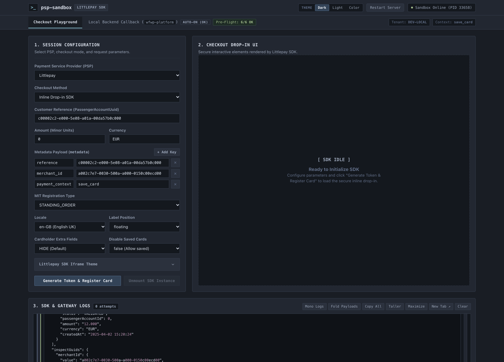

# Multi-PSP Checkout Sandbox & Local Callback Studio (`Littlepay` & `Moneris`)

An interactive developer console for testing **Inline JavaScript SDK Drop-in**, **Hosted Payment Link**, **Vault Tokenization (MIT / CIT)**, and **Local Backend Webhook/Callback Forwarding (`wfwp-platform`)** across **Littlepay** and **Moneris**.

Runs on a zero-dependency Node.js proxy server (`server.js`) that loads credentials from `env.local.json` (falling back to `env.json`), inspects local Docker/PostgreSQL containers, signs webhooks, and forwards payment callbacks directly to your local backend.

👉 **Quick Start Guide:** See [**HOWTO.md**](HOWTO.md) for a concise step-by-step usage cheat sheet.



---

## Key Features

- **Multi-PSP Checkout Playground**:
  - **Littlepay**:
    - **Inline Drop-in SDK (v2)**: Mounts the `LittlePay` v2 card form inline, intercepts SDK network calls (`fetch` / `XHR`), and inspects the resulting Payment Intent, Funding Source, and Transaction via backend APIs.
    - **Hosted Payment Link**: Generates a Littlepay v2 hosted payment link and inspects its status on demand.
  - **Moneris**:
    - **Moneris Checkout (MCO) Drop-in**: Runs a server-to-server `preload` request to obtain a 30-character ticket, mounts the full-height `monerisCheckout` iframe, and verifies the receipt (`/api/moneris-receipt`) automatically upon completion.
    - **Checkout Profile Switcher & Hot-Restart**: Switch between the 3 Moneris QA `checkout_id` profiles (`save_card_*`, `payment_with_save_card_*`, `payment_without_save_card_*`), sync `env.local.json` and local PostgreSQL (`fare_merchants.checkout_profiles`), automatically adjust `orderAmount` / `payment_context` / `reference`, and hot-restart the Node server in one click.
    - **Pay with Saved Data Key (Moneris Vault)**: Execute server-to-server `res_purchase_cc` or `res_card_verification_cc` charges against saved Vault `data_key` tokens with configurable crypt types (`7`, `1`, `2`) and MIT/CIT COF indicators.
- **Local Backend Callback Studio (`wfwp-platform`)**:
  - **5-Step Sequential Workflow (`01` → `05`)**:
    1. **Target Server & Payment Context**: Auto-detects your local `wfwp-platform` container (`127.0.0.1:8099`) and toggles between `save_card` (Passenger Account) and `cart` (Shopping Cart Sale).
    2. **DB Entities & Custom UUIDs (UUIDv5)**: Discovers merchants, passengers, and shopping carts from local PostgreSQL (`2cloud-postgres_main-1`) and encodes raw integer IDs into tenant-scoped UUIDv5 strings.
    3. **PSP Callback Payload & Security**: Signs Littlepay `Event-Signature` (`HMAC-SHA256`) headers or constructs Moneris receipt callback payloads (`X-Payment-Provider: moneris`).
    4. **Pre-Flight Setup Checks (`6/6`)**: Validates container reachability, UUIDv5 format, `fare_merchants` records, webhook secrets/API tokens, target entity existence, and Messenger queue availability.
    5. **Forward Callback & Verify DB Persistence**: Dispatches `POST /billing/payment/callback/{customerShortname}`, optionally runs `messenger:consume billing_sale_event_transport --limit=1`, and queries `fare_payment_tokens`, `fare_sales`, and `shopping_carts` to confirm persistence.
- **Ergonomic 3-Panel Layout & Live Logs Console**:
  - **Panels 1 & 2 Side-by-Side**: Session Configuration (`1`) and Checkout Viewport (`2`) sit side-by-side on top; the Moneris Drop-in iframe fills 100% of the viewport container.
  - **Full-Width Bottom Logs (`3. SDK & Gateway Logs`)**: Spans 100% width below Panels 1 & 2, grouping logs by payment attempt with collapsible JSON payloads, `Mono Logs`, `Fold Payloads`, `Copy All`, `Taller`, `Maximize`, and `New Tab ↗` (`/?view=logs` synchronized via `BroadcastChannel`).
- **Persistent UI Themes (`Dark`, `Light`, `Color`)**:
  - Switch between **Dark** (Nordic Slate `#191d24`), **Light** (Crisp Developer Paper `#f1f5f9`), and **Color** (Cosmic Indigo & Cyan `#0f1021`) in the header.
  - Automatically remembered in `localStorage` (`psp_sandbox_ui_theme_v1`) and restored synchronously in `<head>` before first paint.

---

## File Structure

- `index.html`: Workspace layout (Header & Theme Switcher, Checkout Playground 3-panel grid, and Local Backend Callback 5-step studio).
- `style.css`: Semantic CSS variable themes (`nordic`, `light`, `color`), responsive 3-panel grid, and log console styling.
- `app.js`: PSP registry (`SUPPORTED_PSPS`), SDK mounting/cleanup, Moneris profile synchronization, Local Backend Callback studio, and live log grouping.
- `server.js`: Zero-dependency Node.js HTTP server & proxy for Littlepay, Moneris, local PostgreSQL inspection, Docker Messenger queue consumption, and hot-restart.
- `HOWTO.md`: Concise operational guide for daily usage.
- `env.json`: Committed configuration template.
- `env.local.json`: Git-ignored local credentials override.

---

## Extensible PSP Architecture

Adding a new PSP requires two steps:

1. **Frontend (`app.js` → `SUPPORTED_PSPS`)**: Register the PSP descriptor (`id`, `name`, `badge`, `defaultCurrency`, `supportedMethods`, `features`, `containerId`, `checkSdkAvailable`, `cleanup`, `mount`).
2. **Backend (`server.js` → `PSP_HANDLERS`)**: Implement `handle<Psp>Session(sessionParams, res)` and add it to `PSP_HANDLERS`.

---

## Quick Setup

1. Create `env.local.json` in the project root:
   ```json
   {
     "LITTLEPAY_API_KEY": "your_littlepay_sandbox_key",
     "MONERIS_STORE_ID": "monca15557",
     "MONERIS_API_TOKEN": "your_moneris_api_token",
     "MONERIS_CHECKOUT_ID": "chktCFAGT15557",
     "MONERIS_CHECKOUT_PROFILES": {
       "save_card_light": "chktCFAGT15557",
       "save_card_dark": "chktCFAGT15557",
       "payment_with_save_card_light": "chktTHANC15557",
       "payment_with_save_card_dark": "chktTHANC15557",
       "payment_without_save_card_light": "chktRGSK815557",
       "payment_without_save_card_dark": "chktRGSK815557"
     },
     "MONERIS_ENV": "qa"
   }
   ```
2. Start the server:
   ```bash
   node server.js
   ```
3. Open **`http://localhost:8000`** (and see [**HOWTO.md**](HOWTO.md) for usage instructions).
